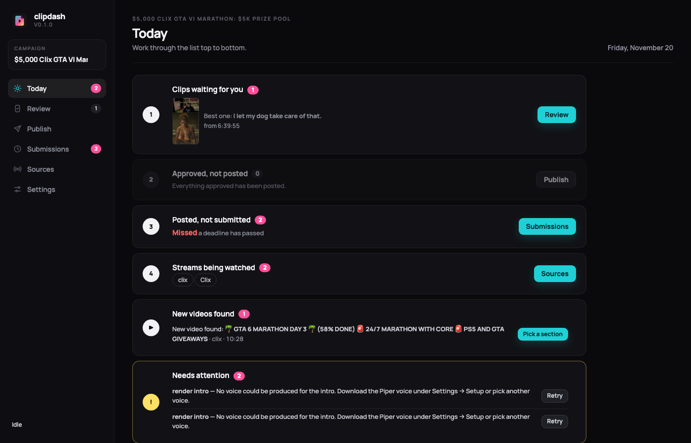
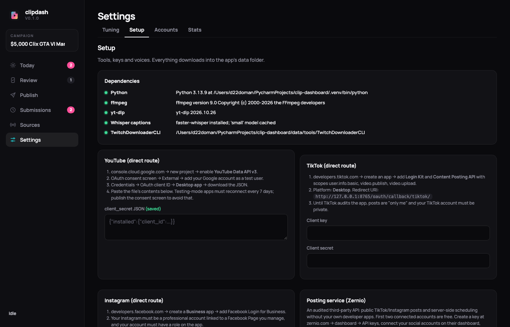
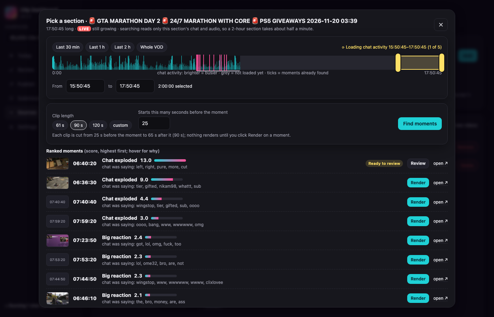
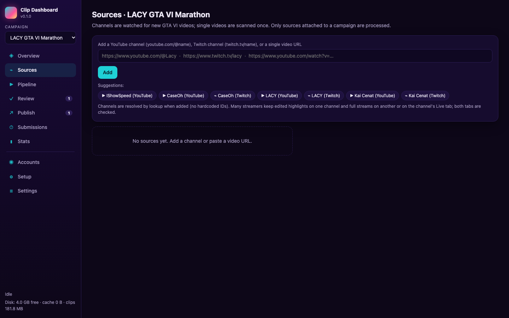
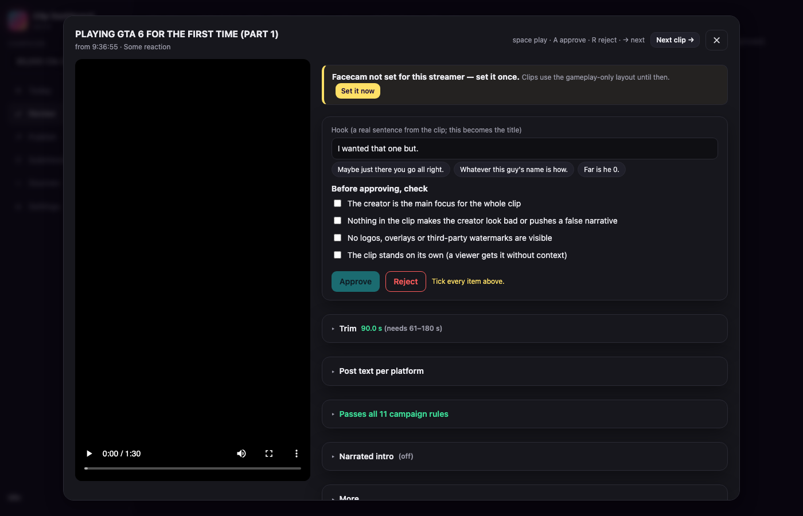
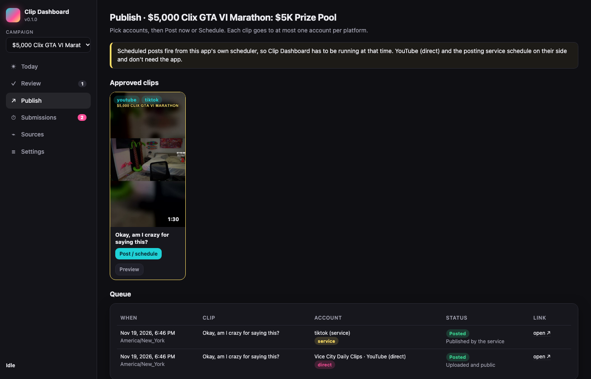

# Clip Dashboard

Turns streamers' GTA VI videos into vertical, captioned clips for paid clipping campaigns, lets you review
each one, and posts or schedules the approved ones to YouTube, TikTok and Instagram. Runs on your own
computer with your own accounts. Nothing is automatic past the point where a person watches the clip:
every post is something you approved.



## What it does

The sidebar has six places: **Today**, **Review**, **Publish**, **Submissions**, **Sources** and **Settings**. Today is a
checklist that drives the day: clips waiting for you, approved clips not yet posted, posted clips not yet submitted (with
the soonest countdown), the channels being watched (live ones marked LIVE), new videos found (each with *Pick a section*)
and anything that failed, each with one button.

1. **Campaign** – you paste the campaign's rules (creator, required name and hashtag, minimum length,
   platforms, footage dates, submission deadline, pay). Rules are data: the app checks the ones a machine
   can check and shows the rest as a checklist.
2. **Sources** – YouTube/Twitch channels or single videos attached to the campaign. Channels are checked every
   10 minutes (Settings → Tuning), live streams included; a new VOD or video shows on Today as *New video found*
   and nothing is searched until you **pick a section**. Each source opens to show its videos and the ranked
   moments found in each one: a thumbnail, the score with a bar, a plain label (*Chat exploded*, *Big reaction*,
   *Some reaction*, *Quiet*) and what chat was saying; hover for the numbers behind it. Moments where the streamer
   is not talking or chat is spam are tucked under *show skipped*. A visual picker sets where the streamer's
   facecam sits.
3. **Pick a section** – one panel per video: a timeline of the whole VOD with a chat-activity heat strip (loaded in
   the background, 2 hours at a time for Twitch; YouTube's *most replayed* curve for uploads), drag handles or typed
   start/end for the section to search, presets (*last 30 min / 1 h / 2 h / whole VOD*), a clip length (61 / 90 /
   120 s or custom) and the lead-in (default 25 s before the moment). *Find moments* reads only that section's chat
   and audio, so a 2-hour section takes about half a minute. Nothing renders until you click **Render** on a moment
   (auto-render stays available as an off-by-default setting).
4. **Clips** – each searched section is scored for moments (chat spikes, YouTube "most replayed", transcript cues,
   loudness), only the 90-second segments around the best moments are downloaded, Whisper transcribes them,
   captions are burned in and the clip is laid out 9:16 (facecam on top, gameplay below).
5. **Review** – the clip plays full height on the left; on the right: the hook (with three alternatives), the
   checklist, Approve / Reject. Trim, per-platform post text and rule results sit in collapsed sections below;
   rules show as one green line (*Passes all 11 campaign rules*) or a red list. Approve stays disabled, with the
   reason next to it, until the checklist is ticked and every rule passes. Keyboard: space play/pause, A approve,
   R reject, → next clip.
6. **Publish** – post now or schedule (date, time, time zone) to one account per platform through one of
   three routes: *direct* (your own developer app on the official API), *service* (an audited third-party
   posting API), *assisted* (the app reveals the file, copies the caption and opens the upload page).
7. **Submissions** – when a post goes live, a countdown starts (30 minutes for LACY). One click copies the
   link and opens the campaign's submission page; tick *Submitted* when done.
8. **Settings** – tuning, Setup (tools and credentials), Accounts and Stats as tabs.

Status words are plain: *Making clip…*, *Ready to review*, *Finding moments…*, *Posted*, *Needs your upload*. A failure
always shows its cause in one sentence with a *Retry* button (the raw error stays in the tooltip). If the app is closed
mid-render, those clips show *Interrupted — retry* on the next start instead of hanging.

## Install (once, about 5 minutes)

Requirements: **Python 3.10 or newer** from [python.org](https://www.python.org/downloads/) (on Windows tick
*Add python.exe to PATH*). No Docker, Homebrew, conda or Node.

1. Download this repository (green **Code** button → *Download ZIP*, or `git clone …`) and unzip it somewhere
   permanent, e.g. your Documents folder.
2. **macOS:** double-click `install.command`. If macOS refuses to open it, right-click → *Open*.
   **Windows:** double-click `install.bat`.
3. Wait for *Installed*. The installer creates a private `.venv` folder and downloads everything, including
   ffmpeg (bundled in the `imageio-ffmpeg` package, no separate install).

Need about 2 GB of free disk: 400 MB of packages, 500 MB for the caption model, and room for the clips.

## Launch

**macOS:** double-click `Launch.command`. **Windows:** double-click `Launch.bat`.

A terminal window opens, then your browser at `http://127.0.0.1:8765`. Keep the window open while you use the
app. Scheduled posts (except YouTube direct and the posting service, which schedule on their side) only fire
while it runs. Close the window to stop.

First launch opens **Settings → Setup**:



- The dependency list should be green. Click *Download* next to the Whisper caption model (once, ~500 MB).
  TwitchDownloaderCLI is only needed for Twitch chat replays; download it when you add a Twitch source.
- Credentials are optional at this point: assisted posting works without any.

## Make your first clip (about 10 minutes)

1. **Campaign dropdown → + New campaign.** Paste the campaign URL and click *Read page*, or paste the rules text and
   *Pre-fill*. The importer reads the page title, Open Graph tags and visible text only (never scripts or
   styles), fills creator, name, pool/rate, platforms and uses the page as the submission URL. Whop Content
   Rewards pages hide the rules until you join: the form says so and leaves hashtag, name and date fields empty
   until you paste the rules. Check every field against the campaign page, especially the required hashtag,
   minimum length (61 s by default), footage start date, submission URL and deadline. Save.
2. **Sources → paste a video URL → Add**, or wait for a watched channel to surface it on Today as *New video
   found*. Either way click **Pick a section**: drag the handles (or type start/end) over the part of the VOD you
   want searched, guided by the chat heat strip, pick the clip length and lead-in, then **Find moments**. The
   panel shows the ranked moments with scores; click **Render** on the ones you want (a 90-second clip renders in
   about a minute and a half on an Apple Silicon Mac). Videos published before the campaign's footage start date
   are skipped silently at add/watch time (logged, not listed); a *Show skipped (N)* toggle at the bottom of
   Sources reveals them, and *Pick a section* there overrides the date window. The first render also loads the
   Whisper model, which takes a minute.



   For a channel instead of a single video, add `youtube.com/@name` or `twitch.tv/name` in the same box;
   the suggestion chips resolve IShowSpeed, CaseOh, LACY and Kai Cenat by lookup.


3. **Set the facecam once per streamer.** The first clip from a new streamer shows a yellow banner in Review
   (*Facecam not set for this streamer*) with the picker inline: grab a frame, drag a box around the webcam, save,
   or choose *No facecam* so it stops asking. Clips rendered before that use the gameplay-only layout; *Re-render*
   (under *More*) applies the crop.
4. **Review.** Open a clip; it plays on the left. Pick a hook from the three chips or type one, tick the checklist,
   **Approve** (or press A). The line next to the button says what still blocks approval. Open *Trim* if the clip
   should start later or end earlier (the length must stay inside the campaign's limits; the number turns green),
   *Post text* to check captions per platform (the required name and tag are added for you), *Rules* to see the
   checks.



5. **Settings → Accounts → Add account.** Start with route *Assisted* for each platform you use. Add *Direct* or
   *Service* accounts later (see below).
6. **Publish → Post / schedule.** Tick accounts, choose *Post now* or *Schedule* with a time zone, confirm.
   Assisted posts appear in the queue with *Open upload page*, *Copy caption* and *Reveal file*; upload in the
   browser, paste the post link back and click *Live*.
7. **Submissions.** The countdown runs from the moment the post is live. *Copy + open submission page*, paste
   the link there, tick *Submitted*. When the countdown reaches zero the row turns to **Missed** (no negative
   timer) with *Mark submitted anyway* in case you submitted outside the app; the campaign may reject late ones.
   Rows are sorted active → missed → done. A post sent through the posting service shows *Posted, fetching link…*
   until the service reports the platform link (polled every 30 s for 15 minutes); if none arrives, *Open on
   TikTok* and a paste field let you fill it in by hand. The app warns before anything that would edit or delete
   a submitted post. The page works at phone width, so you can submit from your phone while the computer renders.



## Streamer clips (no campaign)

The campaign dropdown also offers **Streamer clips (no campaign)**: a workspace for clipping big streamers you
have no campaign with (Speed, CaseOh, Kai Cenat…). Sources are their channels or video URLs, watched and
scanned exactly like campaign sources, but:

- Before adding a source you must tick *This creator publicly allows clipping* (a `!clipping` program or
  clip-friendly terms). Paste a link to their terms and the source card shows it.
- Clips have no campaign rules (only the 9:16 format and clean-text checks) and no submission tracker.
- Captions open with a credit line that names the streamer and their handle. The template is editable per
  source: `{hook} — clip from {creator}'s stream ({handle})`.
- Clips go through Review and Publish like everything else and can use your connected accounts.
- If a streamer also has an active campaign in the app, adding them here is blocked and you are pointed to
  the campaign, so its rules and submissions apply.

## Narrated hook intro (optional, off by default)

A 3–6 second intro before a clip: a synthetic voice reads a one-sentence cliffhanger hook over the clip's first
frame (slow push-in, darkened 40%) while the hook's words appear one by one in sync with the voice, in the same
caption style as the clip, then the real clip plays. Voice starts within the first second; the real action starts by
about second 4. The word timing comes from running the voice file through the same Whisper model as the captions. The frame behind the intro is a caption-free render of the clip's first second, saved at render time, so the clip's own captions never show through (clips rendered before this change fall back to their first frame; Re-render to fix).
When narration is on, the Review player and the Publish preview play the narrated file by default, with a small
*Original* toggle under the player (opening *Trim* switches to the original, since trimming applies to the clip).

- **Per campaign:** *AI narration allowed* in the campaign rules, default off. When the campaign's rules ban
  AI-generated content (the LACY campaign does; *Read page* detects "no AI" wording) it is locked off and the
  UI says why. In the Streamer clips workspace it is available.
- **Hooks** are written by a model from the clip's transcript and chat context (Setup → Narration: Anthropic
  Claude by default, OpenAI as the alternative; the key stays in `data/secrets.json`). Review shows the chosen
  hook as an editable field with three alternatives; nothing renders until you have seen it. Hooks must be under
  15 words, pass the profanity filter and stay factual about what happens in the clip.
- **Voice:** *Auto* uses ElevenLabs if its key is saved, else OpenAI if its key is saved (`gpt-4o-mini-tts` or
  `tts-1-hd`; voices such as ash, onyx, nova), else Piper (local, free; `en_US-ryan-high` by default, with
  `en_US-hfc_male-medium` and `en_GB-alan-medium` as alternatives, each a one-time 60–120 MB download), else the
  computer's built-in voice. Settings → Setup → Narration has a voice picker for Piper, OpenAI and ElevenLabs with a
  two-second *Play sample* per voice; samples are kept on disk after the first play, so they are instant.
- **Disclosure:** posts of narrated clips set YouTube's *altered or synthetic content* flag
  (`containsSyntheticMedia`) and TikTok's AI-generated label (`is_aigc`) automatically; the assisted route adds a
  reminder to the caption file. "AI voice" appears in the clip's rule results.
- The intro is rendered as a separate segment and concatenated in front of the clip; the original clip is kept,
  so narration can be switched off and the clip re-exported. The total length must still meet the campaign minimum.

## Connecting accounts

Each account uses one route. Settings → Accounts shows what every route can and cannot do. A failed post shows
the platform's own message and a suggested fix next to *Retry*.

| Route | YouTube | TikTok | Instagram |
|---|---|---|---|
| **Assisted** | always works | always works | always works |
| **Direct** (your own developer app) | public uploads, native scheduling via `publishAt` | private ("only me") until TikTok audits your app; account must be private; or send to inbox as a draft | Reels upload via Facebook Login for Business; no scheduling on Instagram's side |
| **Service** (Zernio) | public, scheduled on their side | public, scheduled on their side | public, scheduled on their side |

### YouTube direct
1. [console.cloud.google.com](https://console.cloud.google.com) → new project → enable **YouTube Data API v3**.
2. OAuth consent screen → External → add your Google account as a test user.
3. Credentials → Create credentials → OAuth client ID → **Desktop app** → download the JSON.
4. Setup → paste the JSON → Save. Accounts → Add account → YouTube / Direct → **Connect** (a Google sign-in
   tab opens) → **Test**.
A consent screen left in *Testing* expires its tokens every 7 days; publish it to avoid reconnecting.
Default quota is 100 uploads per day.

### TikTok direct
1. [developers.tiktok.com](https://developers.tiktok.com) → create an app → add **Login Kit** and
   **Content Posting API**; scopes `user.info.basic`, `video.publish`, `video.upload`; platform **Desktop**.
2. Redirect URI: `http://127.0.0.1:8765/oauth/callback/tiktok/`.
3. Setup → client key + secret → Save. Accounts → TikTok / Direct → Connect → Test.
Until TikTok audits the app, posts can only be *Only me* and the TikTok account must be private; you flip the
video to *Everyone* in the TikTok app and paste its link. *Send to inbox as a draft* hands the video to the
TikTok app to finish there.

### Instagram direct
1. [developers.facebook.com](https://developers.facebook.com) → create a **Business** app → add Facebook
   Login for Business. Your Instagram must be a professional account linked to a Facebook Page you manage,
   and your account must have a role on the app (then no App Review is needed for your own account).
2. Valid OAuth redirect URI: `http://localhost:8765/oauth/callback/instagram/`.
3. Setup → App ID + secret → Save. Accounts → Instagram / Direct → Connect → Test.

### Posting service
Zernio (formerly Late) is wired in as the service adapter: first two connected accounts are free, posts are
unlimited, uploads go through a presigned URL and the API returns the post link. Create an API key on their
dashboard, connect your social accounts there, paste the key in Setup, then add accounts here with route
*Service*. Other services (Post Bridge, Blotato, Upload-Post) have similar APIs; the adapter lives in
`clipdash/publish/service.py`.

## Rules the app holds to

- Official routes only: platform APIs or an audited posting service. No browser automation, cookies or
  private endpoints.
- A person approves every clip; there is no auto-approve.
- No inflated numbers: nothing generates views, and a clip goes to at most one account per platform.
- Real footage only. Captions transcribe what was said. Hooks are sentences from the transcript; there is no
  model-written text.
- Credentials stay local in `data/secrets.json` (gitignored, user-only permissions). `.env.example` lists them.

## Where things live

```
data/            everything the app writes (gitignored)
  clipdash.db    SQLite state: campaigns, sources, videos, moments, clips, accounts, posts, jobs
  clips/         rendered clips and final trimmed exports
  cache/         downloaded segments, chat replays (pruned automatically, cap in Settings)
  frames/        stills for the facecam picker and thumbnails
  tools/         TwitchDownloaderCLI
  outbox/        files staged for assisted posting
  secrets.json   your credentials
clipdash/        the Python app (FastAPI server, pipeline, publishers) and the UI in clipdash/web
tests/           unit tests (moment scoring, rules, captions, API) and an online end-to-end smoke test
```

## Running the tests

```
.venv/bin/python -m pytest                       # offline unit + API tests, dry-run publishers
CLIPDASH_E2E=1 .venv/bin/python -m pytest tests/test_e2e_smoke.py   # scans and renders one real clip (network)
```
Tests never post to real accounts: publishers run in dry-run mode under test, and *Dry run* can also be
switched on in Settings for manual testing.

Before pushing, `.venv/bin/python scripts/secret_scan.py` checks the tree for credentials. To run it on every
push automatically: `printf '#!/bin/sh\n.venv/bin/python scripts/secret_scan.py\n' > .git/hooks/pre-push && chmod +x .git/hooks/pre-push`.

## Troubleshooting

- **"Python not found"** – install from python.org, tick *Add to PATH*, run the installer again.
- **Download fails / "Sign in to confirm you're not a bot"** – yt-dlp needs updating; run the installer
  again (it upgrades packages).
- **Captions missing on Windows** – the bundled ffmpeg includes libass; if a font error appears, install
  the Arial font or change the font name in `clipdash/cut.py`.
- **Disk full** – the sidebar warns under 2 GB free; Settings → *Clear cache now*, lower the cache cap, or move `data/` with `CLIPDASH_DATA`.
- **Twitch chat fails** – Settings → Setup → download TwitchDownloaderCLI; on macOS the quarantine flag is removed
  automatically.
- **Port 8765 busy** – set `CLIPDASH_PORT` before launching.

## What was not verified

Built on macOS (Apple Silicon). Things that could not be exercised from here:

- The Windows installer and launcher, and caption burn-in with the Windows ffmpeg build (its library list
  includes libass, so it should work).
- Live posting through the TikTok, Instagram and Zernio adapters (written from the official docs read on
  19 November 2026, tested only in dry-run mode). TikTok's desktop PKCE docs describe a hex-encoded code
  challenge; a setting switches to the standard base64url form if the hex one is rejected.
- Whether TikTok's inbox/draft flow is exempt from the "private only" rule for unaudited apps (docs are silent).
